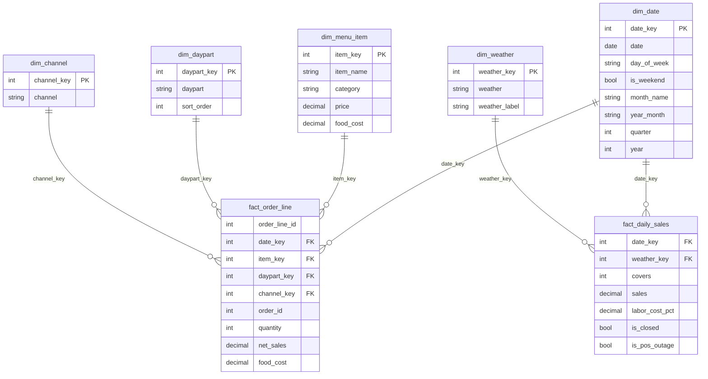

# Restaurant Sales Forecasting (Portfolio Project)

Data is simulated by [`src/simulate_restaurant_sales.py`](src/simulate_restaurant_sales.py), calibrated to patterns from working as a line cook at a casual-dining restaurant. No real POS or financial data.

## Project goal

End-to-end portfolio project: calibrated sales simulation, EDA, and a forecasting model comparison on a proper holdout — plus a [BI layer](#bi-layer) (DuckDB SQL star schema, automated data-quality checks, Power BI report) built on the same data.

## Repo structure

```
data/           daily_sales.csv/.parquet, orders.parquet, order_lines.parquet, menu_items.csv (simulated)
notebooks/      01_eda.ipynb, 02_modeling.ipynb
src/            simulate_restaurant_sales.py, simulate_transactions.py, build_warehouse.py, export_powerbi.py
sql/            01_staging.sql .. 05_analysis.sql (DuckDB star schema + quality checks + analysis views)
sql/tsql/       the same pipeline in SQL Server T-SQL, with a DuckDB vs. T-SQL comparison
warehouse/      restaurant.duckdb (built, not committed — see "BI Layer" below)
powerbi/        BUILD_GUIDE.md, measures.dax, data/*.csv
```

## Methodology

Calibration is based on personal experience working as a line cook at a casual-dining restaurant: weekday vs. weekend volume, check size, seasonal slow/busy periods, weather and promo impact, staffing patterns.

- ~940 days generated with numpy/pandas: day-of-week effects, monthly seasonal curve, weather variable, promo/special days, Poisson covers, lognormal check sizes.
- A handful of incomplete days (simulated POS outages, partial-field gaps, real closures) included for the cleaning step.
- Simulation script validates itself — prints the weekend/weekday ratio and the summer-vs-October swing against the calibration targets.
- EDA: day-of-week/monthly patterns, weather and special-day impact, trend/seasonal decomposition, missing-data handling.
- Forecasting: SARIMA, XGBoost, and Ridge regression, compared on a 90-day time-based holdout (no shuffling).

## Calibration approach

| Parameter | Simulated value | Source |
|---|---|---|
| Weekday sales | ~$5,000-6,000/day | Recalled |
| Weekend sales | ~$10,000-12,000/day | Recalled |
| Weekend/weekday ratio | ~2.0x | Derived, used as validation target |
| Average check | $25-30/person, bigger on weekends | Recalled |
| Seasonal shape | Summer = low point, climbs to a peak in October, shallower dip in January | Recalled |
| Seasonal swing | ~15-20%, summer trough to October peak | Estimated from back-of-house staffing headcount (summer schedules ~15-20% lighter) |
| Weather | Rain -5 to -8%, heavy rain -10 to -15%, snow -25 to -35% | Direction recalled; magnitude from [published restaurant weather-impact data](https://www.teamupwithliberty.com/post/how-weather-affects-restaurants-sales) for a similar climate |
| Promos | Summer-long deal, Thanksgiving/Christmas turkey dinner (special-day tier), one annual signature promo day (slight YoY uptrend) | Recalled |
| Labor cost | 25-33% of sales target band | Target-band approximation — only back-of-house headcount was available, not FOH or wage data |
| Special days / closures | Closed every Dec 25, Mother's/Father's Day at $20-25k, one-off windows for grad season and a 2026 major sporting event (anonymized) | Recalled |

## Model comparison

90-day holdout, 2026-04-21 to 2026-07-19, no shuffling:

| Model | MAE | MAPE |
|---|---|---|
| SARIMA (1,1,1)(1,1,1,7) | $1,445 | 14.4% |
| XGBoost | $959 | 11.7% |
| Ridge (linear + Fourier terms) | $1,012 | 12.4% |

XGBoost has the lowest error, with Ridge close behind. Ridge gets most of the way to XGBoost's accuracy once seasonality is fed in explicitly as Fourier terms — the remaining gap is likely XGBoost picking up interactions (e.g. weather affecting weekends and weekdays differently) that Ridge would need explicit interaction terms for.

SARIMA trails both. Its seasonal term is weekly only (`(1,1,1,7)`); a full annual seasonal order isn't practical for daily-frequency SARIMA, so it has no direct way to see the October peak or summer trough. Full comparison and forecast plot in [`notebooks/02_modeling.ipynb`](notebooks/02_modeling.ipynb).

These are simulated numbers with effect sizes chosen by the author — the comparison demonstrates methodology, not real-world forecast accuracy.

## Findings

- Weekend sales ~2x weekday sales.
- Summer is the slow season, not the busy one — sales dip in July/August, recover through October.
- XGBoost and Ridge both beat SARIMA by 30%+ MAE; Ridge nearly matches XGBoost once seasonality is Fourier-encoded.
- Missing data clusters around simulated outages and yearly closures, not randomly — cleaning needs to treat "closed" (true zero) differently from "outage" (needs imputing).

## Reproducing

```bash
pip install -r requirements.txt
python src/simulate_restaurant_sales.py   # regenerates data/daily_sales.{csv,parquet}
jupyter nbconvert --to notebook --execute --inplace notebooks/01_eda.ipynb
jupyter nbconvert --to notebook --execute --inplace notebooks/02_modeling.ipynb
```

## BI Layer

A second, independent layer on top of the same simulated data: order-level
transactions, a SQL star schema in DuckDB, and a Power BI report. It doesn't
touch the forecasting notebooks above or their results — it's a different
grain of the same restaurant, built to show analytical SQL and BI data
modeling rather than forecasting.

### Schema



Two fact tables share `dim_date`, which technically makes this a *fact
constellation* rather than a single star — the usual shape once a warehouse
has facts at more than one grain (order-line vs. daily).

### Running it

```bash
pip install -r requirements.txt
python src/simulate_transactions.py   # generates data/{menu_items.csv,orders.parquet,order_lines.parquet}
python src/build_warehouse.py         # builds warehouse/restaurant.duckdb, runs quality checks + analysis views
python src/export_powerbi.py          # exports dim_/fact_ tables to powerbi/data/*.csv
```

`build_warehouse.py` exits non-zero if any of the 13 checks in
[`sql/04_quality_checks.sql`](sql/04_quality_checks.sql) returns a row:
primary-key and fact-grain uniqueness, no orphan foreign keys, order lines
reconciling to the daily sales total within $1, no orders on closed or
POS-outage days, and no negative amounts.

Then follow [`powerbi/BUILD_GUIDE.md`](powerbi/BUILD_GUIDE.md) to build the
report in the Power BI service (no Power BI Desktop required).

The same warehouse is also written in SQL Server T-SQL in
[`sql/tsql/`](sql/tsql/), with primary/foreign key constraints, run steps
for SQL Server in Docker, and a table of every DuckDB → T-SQL difference.

*Screenshots of the finished report go here once it's built —*
*`powerbi/screenshots/executive-overview.png` and*
*`powerbi/screenshots/menu-daypart.png`.*

### Key findings

Numbers below come straight out of `sql/05_analysis.sql`'s analysis views,
run against the full simulated period (930 valid days, 91,990 orders,
$6,648,518 in total sales).

- Weekend sales average $11,240/day vs. $5,501/day on weekdays — a 2.04x
  ratio, matching the daily-sales simulation's calibration target almost
  exactly.
- Snow days average $5,048 in sales, a 31.4% drop from the $7,359
  clear-day average — by far the largest weather effect in the data
  (rain: -2.5%, heavy rain: -11.0%).
- Mains and Burgers are the two biggest sales categories (32.6% and 21.1%
  of order-line sales) but Mains also carries the highest food cost % on
  the menu at 27.6%, versus 15.9% for Beverages — the categories driving
  the most revenue aren't the cheapest to produce.
- Dinner is dine-in heavy (80% dine-in / 20% takeout, $2.65M vs. $0.67M),
  but Late-night sales split almost exactly 50/50 between the two channels
  ($324,878 dine-in vs. $324,730 takeout) — a different customer pattern
  late at night than at dinner.
- Ribeye Steak is the single highest-grossing item in the Mains category
  ($410,557), despite also carrying the highest individual food cost on
  the menu ($9.80) — it's a top seller and the most expensive dish to plate.

As with the forecasting results above, these patterns come from effect
sizes chosen in the simulators (e.g. the daypart/channel mix is set in
`simulate_transactions.py`), so the SQL is recovering assumptions, not
discovering facts about a real restaurant. What this layer demonstrates is
the modeling, the checks, and the analysis queries.
